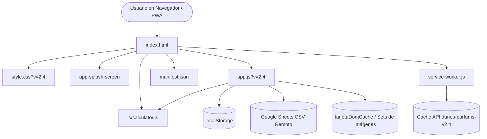

# DUNES PARFUMS — Arquitectura y Estructura del Sistema

> **Fecha del análisis:** 16 de noviembre de 2026  
> **Versión de la aplicación:** v2.4 (PWA Offline / GitHub Pages)  
> **Alcance revisado:** Repositorio completo `./DUNES-APP`, estructura de archivos, módulos JS, maquetación HTML/CSS, flujo de eventos y commits hasta `743935d`.

---

## 1. Árbol de Carpetas y Propósito

```
DUNES-APP/
├── index.html                   # Punto de entrada HTML, vistas (SPA), meta tags iOS y tabs
├── style.css                    # Hoja de estilos de lujo (v2.4), modo oscuro, responsive e iOS safe-areas
├── app.js                       # Controlador principal (2,063 líneas): enrutamiento, catálogo, DOM cache, eventos
├── js/
│   └── calculator.js            # Motor financiero puro (fórmulas courier desacopladas de la UI)
├── service-worker.js            # Service Worker v2.4: precaching estático y estrategia offline completa
├── sw.js                        # Proxy retrocompatible que invoca importScripts('./service-worker.js')
├── manifest.json                # Manifiesto PWA para instalación en iOS/Android standalone
├── favicon.ico                  # Favicon multi-resolución en raíz
├── assets/                      # Recursos visuales primarios enlazados por index.html y service-worker.js
│   ├── logocotizador.png        # Isotipo/Logo oficial de DUNES PARFUMS (512x512)
│   ├── apple-touch-icon.png     # Icono de pantalla de inicio iOS (180x180)
│   ├── icon-192.png             # Icono estándar PWA (192x192)
│   ├── icon-512.png             # Icono estándar PWA (512x512)
│   ├── icon-maskable-192.png    # Icono adaptativo Android maskable (192x192)
│   ├── icon-maskable-512.png    # Icono adaptativo Android maskable (512x512)
│   ├── favicon-16x16.png        # Favicon pequeño para pestañas
│   ├── favicon-32x32.png        # Favicon estándar para navegadores
│   └── favicon.ico              # Favicon en assets
├── icons/                       # Carpeta histórica con copias de los iconos generados
├── logosDP/                     # Archivos originales de identidad gráfica en alta resolución
│   ├── logocotizador.jpeg       # Logotipo fuente
│   ├── logodunesparfumssinfondotextoblanco.png # Versión sin fondo texto blanco
│   └── tiodunesfondotransparente.png           # Variante gráfica con fondo transparente
├── scripts/
│   └── generate_icons.py        # Script Python (Pillow) para regenerar todos los iconos
├── tests/
│   ├── calculator.test.js       # Pruebas unitarias de las fórmulas financieras (11 casos)
│   ├── catalog-filters.test.js  # Pruebas de filtros, acordeón y contadores del catálogo
│   ├── sheets.test.js           # Pruebas del parser CSV RFC 4180 y mapeo A-O de Google Sheets
│   ├── validate-app.js          # Suite de verificación interna de 46 IDs, sintaxis y despliegue
│   └── cdp-desktop-test.js      # Prueba E2E automatizada vía Chrome DevTools Protocol (Edge headless)
├── docs/                        # Documentación histórica y especificaciones iniciales
└── DOCUMENTACION/               # Documentación técnica integral para asistentes IA y desarrolladores
```

---

## 2. Paradigma Arquitectónico y Responsabilidades

DUNES PARFUMS sigue una arquitectura **JAMstack Estática / SPA Vanilla**:

1. **Cero Dependencias de Compilación en Producción:**  
   No existen transpiladores (Babel), empaquetadores (Webpack/Vite) ni frameworks (React/Vue). El navegador ejecuta directamente los archivos nativos.
2. **Separación de Responsabilidades:**
   - **Cálculo Financiero Puro (`js/calculator.js`):** Función libre de efectos secundarios (`calculateDunesQuotation`), sin referencias al DOM ni a `window`. Compatible de forma transparente con CommonJS (`module.exports`) para Node.js y navegador (`window.calculateDunesQuotation`).
   - **Controlador e Interfaz (`app.js`):** Monolito controlador (2,063 líneas) que administra el estado en memoria, escucha eventos del DOM, maneja `localStorage`, orquesta la navegación por pestañas, ejecuta la consulta a Google Sheets y aplica optimizaciones avanzadas de DOM.
   - **Diseño y Estilo (`style.css`):** Arquitectura CSS basada en variables raíz (`:root`), componentes modulares (tarjetas luxury, botones, inputs) y reglas responsivas adaptadas para iPhone y pantallas grandes.
   - **Almacenamiento Local:** No hay base de datos en servidor. Toda la persistencia de cotizaciones y preferencias vive en el almacenamiento local del cliente (`localStorage`).
   - **Fuente de Verdad del Catálogo:** Google Sheets remoto como CMS sin cabeza (*Headless CMS*) accesible vía endpoint CSV público.

---

## 3. Puntos de Entrada y Relación entre Partes



- **Carga Inicial:**  
  `index.html` renderiza un *Splash Screen* animado de lujo (`#app-splash-screen`). Carga `js/calculator.js` primero y posteriormente `app.js?v=2.4`.
- **Inicialización de `app.js` (`DOMContentLoaded`):**
  1. Lee configuración base desde `localStorage` (`dunes_config_base_v1`) o valores de fábrica (`FACTORY_DEFAULTS`).
  2. Lee últimos inputs usados (`dunes_last_inputs_v1`).
  3. Ejecuta el primer cálculo matemático del formulario.
  4. Carga y renderiza el historial de cotizaciones guardadas (`dunes_cotizaciones_v1`).
  5. Consulta el catálogo (primero desde caché en `dunes_catalogo_cache_v2` y en paralelo lanza `fetch` a Google Sheets).
  6. **Garantiza que la pestaña activa inicial sea siempre `#vista-catalogo` (`cambiarPestana('catalogo')`)**, cumpliendo con la regla de negocio comercial donde el catálogo es la pantalla de bienvenida.
  7. Registra el `service-worker.js`.

---

## 4. Vistas, Pantallas y Modales (Enrutamiento Interno)

Al ser una SPA sin hash ni History API, el enrutamiento se gestiona mediante visibilidad de clases CSS (`is-active` / `is-hidden`):

| Vista / Componente | Elemento DOM | Estado Inicial | Propósito y Contenido |
| :--- | :--- | :---: | :--- |
| **Catálogo** | `#vista-catalogo` | **Activo (`is-active`)** | Pantalla principal. Buscador, selector de filtros desplegable, contador de inventario/resultados y tarjetas Luxury con % margen. |
| **Cotizador** | `#vista-cotizador` | Oculto (`is-hidden`) | Formulario de 3 bloques, botones de acción y tarjetas de resultados (Costo Perú y Ganancia reactiva). |
| **Cotizaciones** | `#vista-cotizaciones` | Oculto (`is-hidden`) | Lista de tarjetas históricas y acción para borrar todo el historial. |
| **Modal Detalle** | `#modal-detalle` | Oculto | Ventana emergente con desglose exhaustivo de las variables de una cotización y botón para editar en el cotizador. |
| **Modal Configuración** | `#modal-configuracion` | Oculto | Diálogo para editar tarifas base de courier (peso, flete, precio de caja, TC, extras) y restaurar de fábrica. |
| **Notificaciones Toast** | `#toast-container` | Flotante | Contenedor para alertas no invasivas tipo toast (`toast-success`, `toast-info`). |

---

## 5. Recorrido de los Datos y Optimizaciones de Alto Rendimiento

### Flujo 1: Catálogo Sincronizado y Renderizado de Alto Rendimiento (Commit `743935d`)
1. Al acceder a `#vista-catalogo` o pulsar `#btn-sincronizar-catalogo`:
2. **Caché Instantáneo:** Si hay datos en `dunes_catalogo_cache_v2`, se renderizan de inmediato para latencia cero.
3. **Petición con Timeout:** Se ejecuta `fetch()` con `AbortController` (10s) y parámetro `_t=Date.now()` para invalidar la caché del proxy de Google.
4. **Parser RFC 4180:** Procesa el texto plano CSV respetando celdas con comillas y saltos de línea.
5. **Mapeo A-O:** Se transforman las filas identificando encabezados normalizados o aplicando mapeo por posición de columnas A-O.
6. **Pre-computación de Búsqueda (`prepararCamposBusqueda`):**  
   Para cada perfume se calcula y almacena una sola vez su versión sin acentos ni mayúsculas (`_nombreNorm`, `_catNorm`, `_genNorm`, `_estNorm`), evitando operaciones de `toLowerCase()` y `normalize('NFD')` repetitivas durante el tipeo del usuario.
7. **Caché de Nodos DOM (`tarjetaDomCache`):**  
   Cada tarjeta se identifica mediante una firma única:  
   `id|producto|precioUSA|costoPeru|precioVenta|ganancia|imagen|esAgotado|...`.  
   Si los datos no cambiaron, se reutiliza el elemento DOM exacto, preservando su estado, animaciones e imágenes cargadas sin parpadeo.
8. **Inserción Atómica:** Se utiliza `DocumentFragment` y `catalogoElements.lista.replaceChildren(fragment)` para modificar el DOM en un solo ciclo de renderizado.
9. **Carga Progresiva de Imágenes (`iniciarLazyLoadingCatalogo`):**  
   `IntersectionObserver` anticipa la carga `100px` antes de entrar al viewport. Los sets `imagenesCargadas` e `imagenesFallidas` evitan solicitudes duplicadas.

### Flujo 2: Cotizador en Tiempo Real y Reempaque Dinámico
1. El usuario modifica cualquier input en `#seccion-formulario`.
2. Si el campo es `cantidad`, se recalcula dinámicamente el reempaque según la fórmula de caja courier:  
   $$\text{Reempaque} = \text{Cantidad} \times (\text{Precio Caja} \div 4)$$
3. Se dispara `ejecutarCalculo()`:
   - Sincroniza el nombre del producto en las tarjetas de resultados (`sincronizarNombrePerfume`).
   - Autoguarda las variables financieras en `dunes_last_inputs_v1`.
   - Si `precioUSA <= 0`, oculta desglose y muestra alerta informativa.
   - Si `precioUSA > 0`, invoca `window.calculateDunesQuotation(params)`.
   - Actualiza métricas de la tarjeta Costo Perú (Total USA, Flete, Reempaque, Total USD, Costo Perú C/U y Total Soles).
   - Si `venta > 0`, calcula ganancia neta, ganancia del lote y margen porcentual, alternando estilos positivos (`#10b981`) o negativos (`#ef4444`).

### Flujo 3: Guardado e Historial
1. El usuario pulsa `#btn-guardar`.
2. Se valida que exista un precio en USA mayor a 0.
3. Se genera un registro con `id = Date.now()`, fecha formateada legible en zona horaria local (`es-PE`) y las métricas calculadas.
4. Se inserta al inicio de la lista (`unshift`) en `dunes_cotizaciones_v1`.
5. Se invoca `renderizarHistorial()` para actualizar la interfaz y el contador.

---

## 6. Mapeo de Archivos para Mantenimiento y Modificaciones

| Área que se desea modificar | Archivos a intervenir | Consideraciones críticas |
| :--- | :--- | :--- |
| **Fórmulas matemáticas o reglas financieras** | `js/calculator.js`, `tests/calculator.test.js`, `tests/validate-app.js` | Mantener sincronizados los 11 tests unitarios en `tests/calculator.test.js`. |
| **Campos del formulario o nuevas vistas** | `index.html`, `app.js`, `tests/validate-app.js` | Verificar que los IDs agregados existan en ambos archivos para no romper `validate-app.js` (46 IDs verificados). |
| **Estilos, colores, espaciados y tipografía** | `style.css` | Usar variables de `:root` (`--gold-*`, `--bg-*`, `--emerald-*`). Probar responsive en 375px y 1280px. |
| **Estructura o columnas de Google Sheets** | `app.js` (función `convertirFilasACatalogo`), `tests/sheets.test.js` | Revisar el array `idxMap` y el soporte posicional retrocompatible A-O y A-K. |
| **Lógica de filtros o búsqueda** | `app.js` (función `filtrarCatalogo`), `tests/catalog-filters.test.js` | La regla de género exige que "Hombre" y "Mujer" incluyan los productos unisex. |
| **Rendimiento o renderizado del catálogo** | `app.js` (`tarjetaDomCache`, `obtenerElementoTarjeta`, `renderizarCatalogo`) | Mantener la firma de caché sincronizada si se agregan campos a la tarjeta. |
| **Caché offline y soporte PWA** | `service-worker.js`, `manifest.json`, `index.html` | Incrementar la constante `CACHE_NAME` (`v2.4` → `v2.5`) y sufijos `?v=X.X` al modificar activos estáticos para forzar actualización en clientes. |
