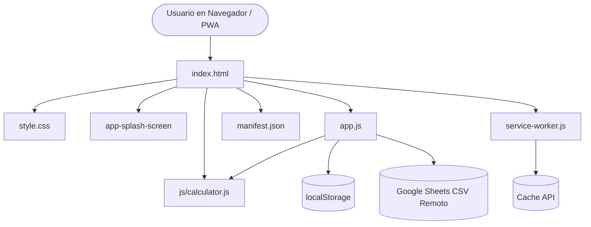

# DUNES PARFUMS — Arquitectura y Estructura del Sistema

> **Fecha del análisis:** 17 de octubre de 2026  
> **Alcance revisado:** Repositorio completo `./DUNES-APP`, estructura de archivos, módulos JS, maquetación HTML/CSS y flujo de eventos.

---

## 1. Árbol de Carpetas y Propósito

```
DUNES-APP/
├── index.html                   # Punto de entrada HTML, estructura de vistas (SPA) y metadatos PWA
├── style.css                    # Hoja de estilos única: diseño de lujo, modo oscuro, responsive e iOS safe-areas
├── app.js                       # Controlador principal de la aplicación, enrutamiento, eventos y sincronización
├── js/
│   └── calculator.js            # Motor financiero puro (fórmulas de importación courier desacopladas de la UI)
├── service-worker.js            # Service Worker oficial: gestión de caché estática y modo offline
├── sw.js                        # Proxy retrocompatible que importa scripts de service-worker.js
├── manifest.json                # Manifiesto de PWA para instalación standalone en dispositivos móviles
├── favicon.ico                  # Favicon multi-resolución en raíz
├── assets/                      # Recursos visuales primarios enlazados por index.html y service-worker.js
│   ├── logocotizador.png        # Isotipo/Logo principal de DUNES PARFUMS (512x512)
│   ├── logohorizontaldunesparfums.webp # Versión horizontal optimizada
│   ├── apple-touch-icon.png     # Icono de pantalla de inicio iOS (180x180)
│   ├── icon-192.png             # Icono estándar PWA (192x192)
│   ├── icon-512.png             # Icono estándar PWA (512x512)
│   ├── icon-maskable-192.png    # Icono adaptativo Android (192x192)
│   ├── icon-maskable-512.png    # Icono adaptativo Android (512x512)
│   ├── favicon-16x16.png        # Favicon pequeño
│   ├── favicon-32x32.png        # Favicon estándar navegador
│   └── favicon.ico              # Favicon en assets
├── icons/                       # Carpeta alternativa con copias de los iconos generados
├── logosDP/                     # Archivos originales de identidad gráfica (JPEG, JPG, PNG de alta resolución)
├── scripts/
│   └── generate_icons.py        # Script Python (Pillow) para regenerar todos los iconos desde logosDP
├── tests/
│   ├── calculator.test.js       # Pruebas unitarias de las fórmulas financieras matemáticas
│   ├── catalog-filters.test.js  # Pruebas unitarias de filtros, acordeón y contadores de catálogo
│   ├── sheets.test.js           # Pruebas del parser CSV RFC 4180 y mapeo A-O de Google Sheets
│   ├── validate-app.js          # Suite de verificación interna y consistencia HTML-JS
│   └── cdp-desktop-test.js      # Prueba E2E automatizada vía Chrome DevTools Protocol (Edge headless)
├── docs/                        # Documentación previa y planes de diseño iniciales
│   └── superpowers/
│       ├── specs/2026-09-05-dunes-parfums-design.md
│       └── plans/2026-09-05-dunes-parfums-app.md
└── DOCUMENTACION/               # Documentación técnica integral para asistentes IA y desarrolladores
```

---

## 2. Paradigma Arquitectónico y Responsabilidades

DUNES PARFUMS sigue una arquitectura **JAMstack Estática / SPA Vanilla**:

1. **Cero Dependencias de Compilación en Producción:**  
   No existen transpiladores (Babel), empaquetadores (Webpack/Vite) ni frameworks (React/Vue). El navegador ejecuta directamente los archivos.
2. **Separación de Responsabilidades:**
   - **Cálculo Financiero Puro (`js/calculator.js`):** Función libre de efectos secundarios (`calculateDunesQuotation`), sin referencias al DOM ni a `window`. Compatible de forma transparente con CommonJS (`module.exports`) para Node.js y navegador (`window.calculateDunesQuotation`).
   - **Controlador e Interfaz (`app.js`):** Monolito controlador que administra el estado en memoria, escucha eventos del DOM, maneja `localStorage`, orquesta la navegación por pestañas y realiza las consultas a la red.
   - **Diseño y Estilo (`style.css`):** Arquitectura CSS basada en variables raíz (`:root`), componentes modulares (tarjetas, botones, inputs) y reglas responsivas adaptadas para iPhone y pantallas grandes.
   - **Almacenamiento Local:** No hay base de datos relacional ni backend propio. Toda la persistencia de cotizaciones y preferencias vive en el almacenamiento local del cliente (`localStorage`).
   - **Fuente de Verdad del Catálogo:** Google Sheets remoto como CMS sin cabeza (*Headless CMS*) accesible vía endpoint CSV público.

---

## 3. Puntos de Entrada y Relación entre Partes



- **Carga Inicial:**  
  `index.html` renderiza un *Splash Screen* animado (`#app-splash-screen`). Carga `js/calculator.js` primero y posteriormente `app.js`.
- **Inicialización de `app.js` (`DOMContentLoaded`):**
  1. Lee configuración base desde `localStorage` (`dunes_config_base_v1`) o valores de fábrica (`FACTORY_DEFAULTS`).
  2. Lee últimos inputs usados (`dunes_last_inputs_v1`).
  3. Ejecuta el primer cálculo matemático del formulario.
  4. Carga y renderiza el historial de cotizaciones guardadas (`dunes_cotizaciones_v1`).
  5. Consulta el catálogo (primero desde caché en `dunes_catalogo_cache_v2` y en paralelo lanza `fetch` a Google Sheets).
  6. Garantiza que la pestaña activa inicial sea siempre `#vista-cotizador`.
  7. Registra el `service-worker.js`.

---

## 4. Vistas, Pantallas y Modales (Enrutamiento Interno)

Al ser una SPA sin hash ni History API, el enrutamiento se gestiona mediante visibilidad de clases CSS (`is-active` / `is-hidden`):

| Vista / Componente | Elemento DOM | Propósito y Contenido |
| :--- | :--- | :--- |
| **Cotizador** | `#vista-cotizador` | Formulario de entrada (3 bloques), botones de acción y tarjetas de resultados visuales (Costo Perú y Ganancia). |
| **Catálogo** | `#vista-catalogo` | Buscador, selector de filtros desplegable, contadores de inventario/resultados y tarjetas de perfumes en modo consulta. |
| **Cotizaciones** | `#vista-cotizaciones` | Lista de tarjetas históricas y acción para borrar todo el historial. |
| **Modal Detalle** | `#modal-detalle` | Ventana emergente con desglose exhaustivo de variables de una cotización guardada y botón para editar en el cotizador. |
| **Modal Configuración** | `#modal-configuracion` | Diálogo para editar tarifas base de courier (peso, flete, precio de caja, TC, extras) y restaurar de fábrica. |
| **Notificaciones Toast** | `#toast-container` | Contenedor flotante para alertas no invasivas tipo toast (`toast-success`, `toast-info`). |

---

## 5. Recorrido de los Datos en los Flujos Principales

### Flujo 1: Cotización en Tiempo Real
1. El usuario modifica cualquier input en `#seccion-formulario`.
2. Si el campo es `cantidad`, se recalcula dinámicamente el reempaque según la fórmula de caja: $\text{Reempaque} = \text{Cantidad} \times (\text{Precio Caja} \div 4)$.
3. Se dispara `ejecutarCalculo()`:
   - Sincroniza el nombre del producto en las tarjetas de resultados (`sincronizarNombrePerfume`).
   - Autoguarda las variables financieras en `dunes_last_inputs_v1`.
   - Si `precioUSA <= 0`, oculta desglose y muestra alerta informativa.
   - Si `precioUSA > 0`, invoca `window.calculateDunesQuotation(params)`.
   - Actualiza métricas de la tarjeta Costo Perú (Total USA, Flete, Reempaque, Total USD, Costo Perú C/U y Total Soles).
   - Si `venta > 0`, calcula ganancia neta, ganancia del lote y margen porcentual, alternando clases de estilo positivas (`#10b981`) o negativas (`#ef4444`).

### Flujo 2: Guardado e Historial
1. El usuario pulsa `#btn-guardar`.
2. Se valida que exista un precio en USA mayor a 0.
3. Se genera un registro con `id = Date.now()`, fecha formateada legible en zona horaria local (`es-PE`) y las métricas calculadas.
4. Se inserta al inicio de la lista (`unshift`) en `dunes_cotizaciones_v1`.
5. Se invoca `renderizarHistorial()` para actualizar la interfaz y el contador.

### Flujo 3: Sincronización del Catálogo con Google Sheets
1. Al acceder a `#vista-catalogo` o pulsar `#btn-sincronizar-catalogo`:
2. Si hay caché previa en `dunes_catalogo_cache_v2`, se renderiza de inmediato para latencia cero.
3. Se construye la URL de descarga: `construirURLGoogleSheetCSV()` añade `&_t=Date.now()` para evitar caché del navegador/CDN de Google.
4. Se ejecuta `fetch()` con `AbortController` (timeout de 10 segundos).
5. Se recibe el texto plano CSV y se procesa mediante `parsearCSV()` (respetando RFC 4180 con comillas y saltos de línea).
6. Se mapean las columnas mediante `convertirFilasACatalogo()` buscando encabezados o asignando por posición A-O.
7. Se almacena la lista resultante en `dunes_catalogo_cache_v2` y la hora en `dunes_catalogo_last_sync_v1`.
8. Se invoca `renderizarCatalogo()`, actualizando el inventario general fijo y los resultados de búsqueda.
9. Se inicializa el `IntersectionObserver` (`iniciarLazyLoadingCatalogo`) para cargar las imágenes de los perfumes solo cuando entran en el viewport.

---

## 6. Mapeo de Archivos para Mantenimiento y Modificaciones

| Área que se desea modificar | Archivos a intervenir | Consideraciones críticas |
| :--- | :--- | :--- |
| **Fórmulas matemáticas o reglas financieras** | `js/calculator.js`, `tests/calculator.test.js`, `tests/validate-app.js` | Mantener sincronizados los tests unitarios en `tests/calculator.test.js`. |
| **Campos del formulario o nuevas vistas** | `index.html`, `app.js`, `tests/validate-app.js` | Verificar que los IDs agregados existan en ambos archivos para no romper `validate-app.js`. |
| **Estilos, colores, espaciados y tipografía** | `style.css` | Usar variables de `:root` (`--gold-*`, `--bg-*`, `--emerald-*`). Probar responsive en 375px y 1280px. |
| **Estructura o columnas de Google Sheets** | `app.js` (función `convertirFilasACatalogo`), `tests/sheets.test.js` | Revisar el array `idxMap` y el soporte posicional retrocompatible. |
| **Lógica de filtros o búsqueda** | `app.js` (función `filtrarCatalogo`), `tests/catalog-filters.test.js` | La regla de género exige que "Hombre" y "Mujer" incluyan los productos unisex. |
| **Caché offline y soporte PWA** | `service-worker.js`, `manifest.json` | Incrementar la constante `CACHE_NAME` (`v2.4` → `v2.5`) al modificar activos estáticos para forzar actualización. |
